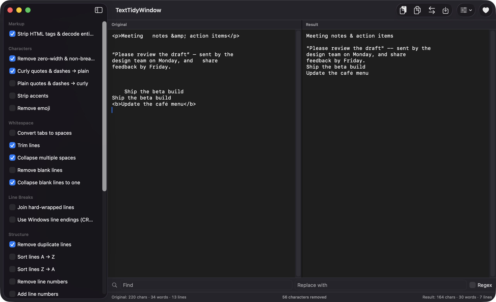
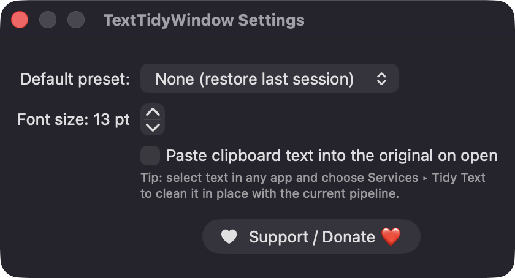
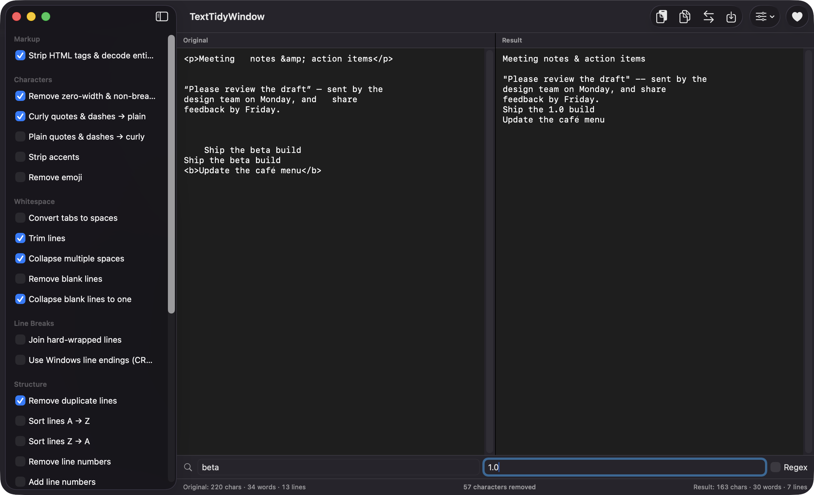

# TextTidyWindow

**🌐 Website:** [turhe123.github.io/text-tidy-window](https://turhe123.github.io/text-tidy-window/)

Paste messy text, toggle cleaners like fixing line breaks or smart quotes, and copy the tidy result.

[](https://github.com/turhe123/text-tidy-window)
[](https://swift.org)
[](#license)
[](https://github.com/turhe123/text-tidy-window/releases/latest)

## Why

TextTidyWindow is a free, open-source, 100% native, backend-free alternative to paid utilities in the *Text & Input* category. It was inspired by tools such as TextSoap ($19.99 one-time), which many people rely on to tame text copied from PDFs, emails and web pages. TextTidyWindow takes a smaller, focused approach: a single document-style window with a live before/after view, rather than an automatic clipboard rule engine.

## Features

- **Two live panes**: type, paste, or drop a text file into the *Original* pane and see the cleaned *Result* update as you go (debounced, and computed off the main thread so large text stays responsive).
- **22 toggleable cleaners** in six groups:
  - **Markup**: strip HTML tags and decode entities (named and numeric).
  - **Characters**: remove zero-width and non-breaking characters; curly → plain quotes/dashes; plain → curly; strip accents; remove emoji.
  - **Whitespace**: convert tabs to spaces, trim lines, collapse multiple spaces, remove blank lines, collapse blank lines to one.
  - **Line Breaks**: join hard-wrapped lines (paragraph breaks are preserved), use Windows (CRLF) line endings.
  - **Structure**: remove duplicate lines, sort A → Z or Z → A, add or remove line numbers, add bullet prefixes.
  - **Case**: lowercase, UPPERCASE, Title Case, Sentence case.
- **Reorderable pipeline**: cleaners run in a sensible default order; drag them in the Pipeline list to change it, or press *Reset Order*.
- **Find & Replace** row with an optional regular-expression toggle, applied as the final step. Invalid regexes show a red message and are skipped.
- **Presets**: save the enabled cleaners and their order by name, apply or delete them from a toolbar menu, and pick a default preset in Settings. Presets are stored as JSON in Application Support.
- **Footer stats**: characters, words and lines for both panes, plus a diff summary such as "42 characters removed".
- **Safe by design**: your original text is never touched until you choose *Swap Result Into Original*, and swapping is undoable. Mixed Windows/Unix line endings are normalised.
- **Large input warning** for text over 2 MB.
- **Keyboard**: ⇧⌘V paste into the original, ⇧⌘C copy the result, ⌘O open a text file.
- **Settings**: default preset, editor font size, and optionally paste clipboard text on launch.

## Screenshots

<p align="center"></p>

<p align="center"><em>Messy pasted text on the left is cleaned live on the right: HTML stripped, entities decoded, curly quotes made plain, spaces collapsed and duplicate lines removed.</em></p>

<p align="center"></p>

<p align="center"><em>Settings let you pick a default preset, set the editor font size and auto-paste clipboard text on launch.</em></p>

<p align="center"></p>

<p align="center"><em>The Find Replace row runs as the final pipeline step, here replacing &quot;beta&quot; with &quot;1.0&quot; in the result.</em></p>

## Install

1. Download `TextTidyWindow-macOS.zip` from the [latest release](https://github.com/turhe123/text-tidy-window/releases/latest).
2. Unzip it and move `TextTidyWindow.app` to `/Applications`.
3. Because the app is open source and not notarized, clear the quarantine flag:

   ```bash
   xattr -cr /Applications/TextTidyWindow.app
   ```

4. Right-click the app and choose **Open** the first time you launch it.

## Build from source

Requires macOS 14+ and Xcode with Swift 5.9 or later.

```bash
brew install xcodegen
xcodegen generate
xcodebuild -project TextTidyWindow.xcodeproj -scheme TextTidyWindow -configuration Release -derivedDataPath ./build build
```

The app is produced at `build/Build/Products/Release/TextTidyWindow.app`.

## Permissions

TextTidyWindow does not request any special permissions. It does not need Accessibility, Screen Recording, or Microphone access, and it makes no network connections. What it does touch:

- **Clipboard**: reads it when you paste (or on launch if you enable auto-paste) and writes it when you copy the result.
- **Files**: reads text files you choose with *Open Text File…* or drop onto the window.
- **Application Support**: saves your presets to `~/Library/Application Support/TextTidyWindow/presets.json`.
- **User defaults**: stores your current pipeline and settings.

The source also contains a `tidyText` Services handler intended for cleaning selected text in other apps. The built app's Info.plist does not currently declare a Services entry, so don't expect a *Tidy Text* item in the Services menu yet.

## Built with AI

TextTidyWindow was written by [Claude Code](https://claude.com/claude-code) inside an automated pipeline, from a plain-English spec. No code, binaries or assets from any commercial app were used; it is a clean-room reimplementation of a feature set, not a copy.

What that means in practice:

- The full source is in this repo under the MIT license. Read it before you run it.
- No network calls, no analytics, no third-party dependencies. Only Apple frameworks.
- Ad-hoc signed and not notarized, which is why Gatekeeper warns on first launch.
- It has had less human review than a hand-written app. Bug reports and pull requests are welcome.

## Support ❤️

If TextTidyWindow saves you time, you can support its development:

[Support Or (Leo) Davidai ❤️ on Ko-fi](https://ko-fi.com/leodavidai)

The app also has a **Support / Donate ❤️** button in the toolbar and in Settings.

## License

MIT © Or Davidai Bachar
